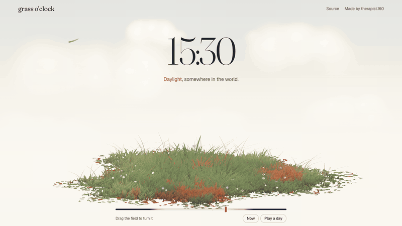

# grass o'clock



A painted patch of grass that follows **your local time**. Daylight, then golden hour backlight, a lavender twilight, and a navy night with stars and fireflies. It changes minute by minute while the page is open.

Drag to turn the field. Move your cursor and it brushes the blades aside.

**[Live demo →](https://vic-chen-160.github.io/grass-oclock/)** (drag the slider at the bottom, or press *Play a day*)

- About 23,000 individually drawn blades, in raw WebGL2. No Three.js, no libraries, no build step.
- Reads the visitor's own clock. No location, no API, no login.
- About 22 KB of JavaScript, gzipped.

Made for my portfolio, [therapist-160.github.io](https://therapist-160.github.io), built with [Claude Code](https://claude.com/claude-code).

[中文說明在下面](#中文)

---

## What's inside

Four plain scripts. Each one works without the others.

| File | What it does |
|---|---|
| [`src/field.js`](src/field.js) | The grass. WebGL2 with an orthographic camera (so it reads like a flat illustration). Blades have round tips and take their colour from a painted "ground colour map", so neighbouring blades form patches. Also handles wind, cursor brushing, growing in from the centre and a bloom pass. |
| [`src/sunlight.js`](src/sunlight.js) | The clock. Blends four looks (day, dusk, twilight, night) by the hour and writes the result to `window.SUNLIGHT`, which `field.js` reads every frame. Also sets page colour CSS variables and draws the sun glow, motes, fireflies and the starry sky. |
| [`src/drift.js`](src/drift.js) | One or two loose blades and the odd petal drifting across the screen. |
| [`src/sky.js`](src/sky.js) | Soft painted clouds behind the field. |
| [`index.html`](index.html) + [`demo/`](demo) | The demo page: the time slider, *Now* and *Play a day*. |

## Use it

No package and no build. Take the files and pull them apart. The smallest setup looks like this:

```html
<div class="sky"><canvas></canvas></div>
<div class="stage" style="position:fixed;inset:0"><canvas style="width:100%;height:100%"></canvas></div>

<script src="src/sky.js"></script>
<script src="src/sunlight.js"></script>
<script src="src/field.js"></script>
<script src="src/drift.js"></script>
<script>
  Sky.paint(document.querySelector('.sky canvas'));
  const field = Field.mount(document.querySelector('.stage canvas'), { seed: 7 });
  const sun = Sunlight.mount({ sky: document.querySelector('.sky'), after: document.querySelector('.stage') });
  Drift.mount();
  field.grow();
</script>
```

Grab the CSS for `.sky`, `.sun` and `.drift` from [`demo/demo.css`](demo/demo.css).

### API

```js
const field = Field.mount(canvas, { seed, steps, zoom, shiftY, elevation, wind, clumps, wisps, dabs, flowers });
field.grow();                 // grow in from the centre
field.setAngle(steps);        // turn the field (one full turn = options.steps, default 24)
field.setPointer(x, y);       // cursor position in px for brushing the grass; null when the cursor leaves

const sun = Sunlight.mount({ sky, after });
sun.setHours(18.5);           // pin the clock to 18:30
sun.setHours(null);           // follow the visitor's clock again
sun.hours; sun.live; sun.state.name;   // 'day' | 'dusk' | 'twilight' | 'night'
```

URL helpers: `?time=19:30` pins the time and `?nosun` keeps it daytime.

### Tweak it

- **When things happen**: `SCHEDULE` at the top of `sunlight.js`. The defaults are a Taiwanese autumn (sunset around 18:00) and don't follow the seasons.
- **How each time looks**: `PRESETS` in `sunlight.js` (shade, rim light, glow, haze, fireflies, stars, page colours).
- **Grass colours**: the `BASE / PALE / DEEP / WARM / COOL / DRY / RED` constants in the shader near the top of `field.js`.
- **How dense the field is**: the `clumps / wisps / dabs / flowers` options.
- **Glow**: `GLOW` in `field.js`. It only runs when the current look asks for bloom, so daytime costs nothing extra.

### Notes

- Needs WebGL2 (every current browser). Without it the canvas simply hides itself.
- `prefers-reduced-motion` is respected: nothing drifts or blinks, but the light still follows the clock.
- `sunlight.js` sets `--paper`, `--ink`, `--ink-2`, `--ink-3`, `--line`, `--red`, `--primary` and a few more on `<html>` after dusk. Use them in your CSS and your text will flip to light colours at night.

## Credits

- Built by Vic Chen ([therapist.160](https://therapist-160.github.io)) with Claude Code.

## License

[MIT No Attribution (MIT-0)](LICENSE). Use it for anything, including client work. No credit or licence notice required.

---

## 中文

一片會跟著**你當地時間**變化的手繪感草地。白天是一般的光線，接著是黃昏逆光、紫色暮光，入夜後變成深藍色的夜空，有星星和螢火蟲。網頁一直開著的話，畫面會一分一分慢慢變化。

拖曳可以轉動草地，游標滑過時會把草撥開。

**[線上示範 →](https://vic-chen-160.github.io/grass-oclock/)**（拖底下的時間滑桿，或按「Play a day」看一整天的變化）

- 大約 23,000 根草，每一根都是單獨畫出來的，用純 WebGL2，沒用 Three.js、沒用任何套件、不需要打包
- 只讀訪客裝置上的時鐘，不需要定位、不需要 API、不需要登入
- JavaScript 壓縮後約 22 KB

這原本是做在我的作品集 [therapist-160.github.io](https://therapist-160.github.io) 上的效果，用 Claude Code 做的。

**怎麼用**：這裡沒有安裝套件，直接把 `src/` 裡的檔案拿去拆。最小的範例在上面的「Use it」段落。四支檔案彼此獨立，只想要草地、只想要天色變化都可以。

**想改的話**：
- 幾點變黃昏、幾點入夜：`sunlight.js` 最上面的 `SCHEDULE`
- 每個時段的樣子：`sunlight.js` 的 `PRESETS`
- 草的顏色：`field.js` 著色器裡的 `BASE / PALE / DEEP…`

**授權**：MIT-0（MIT 免署名版），接案、商業用途都可以，不需要保留任何聲明。
